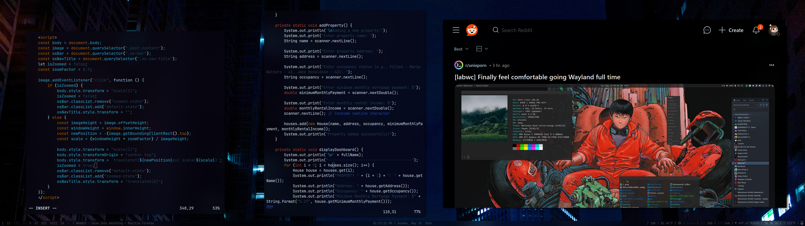

Screenshot of Exyn, showing the desktop environment, application launcher, and system panel.

Screenshot of Exyn showing an active application and desktop elements including the system panel and app icons.

Screenshot of Exyn showing an active application and desktop elements including the system panel and app icons.

#### Description

Exyn is a complete system and toolkit environment designed for deployment, management, and operational use.
Exyn provides a curated set of tools, scripts, packages, configurations, and supporting components intended to deliver a functional, consistent platform across supported use cases.
Suitable for individual, team, and organizational environments. Components and configurations may be adapted to specific operational requirements.

#### Disclaimer

Exyn and its associated toolkit, including all tools, scripts, packages, configurations, and supporting components, are provided "AS IS" without warranty of any kind, express or implied, including but not limited to merchantability, fitness for a particular purpose, or non-infringement.

By installing, deploying, configuring, or using any part of this environment, you acknowledge and agree that:

- You assume full responsibility for all installation, configuration, and operational decisions.
- The provider(s) shall not be liable for any damages arising from use, including data loss, downtime, security incidents, or degraded performance.
- Verified backups, testing, and change-management procedures are strongly recommended before any deployment.
- Certain components operate with elevated privileges and, if misconfigured, may affect system integrity or operational continuity.
- Compliance with applicable policies, security standards, and regulatory requirements remains the responsibility of the deploying party.

If you do not accept these terms, do not install or use Exyn or any of its components.

#### Release v0.0.0.1

Initial release.
